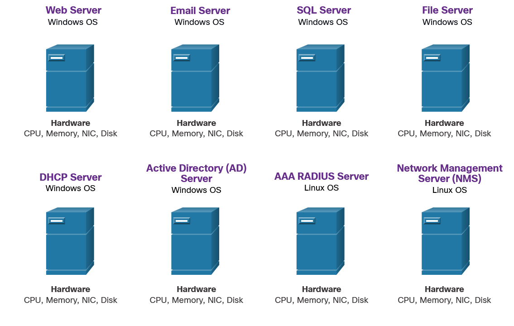
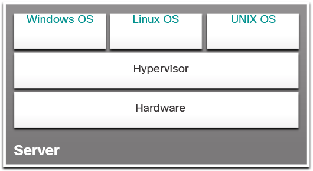
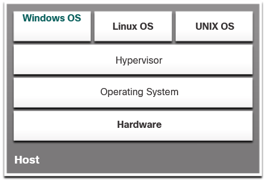

# Лекция: Облаци и виртуализация

**Дисциплина:** Проектиране на комуникационни и компютърни системи  
**Преподавател:** гл. ас. Светослав Атанасов  
**Email:** svetoslav.atanasov@trakia-uni.bg  

**Тема:** Характеристики на облаците и облачни услуги. Предназначение, характеристики и предимства на виртуализацията.

---

## Въведение в курса

Курсът "Networking Devices and Initial Configuration" преподава междинни знания и умения за мрежите, като обхваща основните концепции и умения, необходими за изграждане на домашна офис мрежа и малка корпоративна мрежа на Cisco.

### След завършване на курса студентите ще могат да:

- Обясняват компонентите на йерархичния мрежов дизайн
- Обясняват характеристиките на виртуализацията и облачните услуги
- Изчисляват числа между десетични, двоични и шестнадесетични системи
- Обясняват как Ethernet функционира в комутирана мрежа
- Обясняват как рутерите използват мрежови протоколи на слой 3
- Изчисляват IPv4 подмрежова схема
- Обясняват как ARP позволява комуникация в локална мрежа
- Обясняват как DNS и DHCP услугите функционират
- Сравняват операциите на транспортни протоколи
- Използват Cisco IOS
- Изграждат проста компютърна мрежа
- Използват различни инструменти за тестване

---

## Цел на модула

**Module Objective:** Обяснение на характеристиките на виртуализацията и облачните услуги.

### Защо облачни услуги?

- По-малко енергопотребление
- По-малко необходимо оборудване
- По-малко необходимо пространство
- Помага при възстановяване при бедствия

**Аналогия:** Подобно на резервно копие на снимки от мобилен телефон в облака - дори ако телефонът бъде повреден, снимките могат да бъдат възстановени.

---

### Три основни понятия за облака:

**1. Центрове за данни (Data centers)**

Обикновено големи съоръжения, които предоставят:
- Масивни количества електроенергия
- Охлаждане
- Широколентова връзка

Само много големи организации като Facebook или Google могат да си позволят собствени частни центрове за данни. Други организации наемат пространство.

**2. Облачни изчисления (Cloud computing)**

Доставчици като Cisco, Amazon Web Services (AWS) и Microsoft Azure предлагат услуги от центрове за данни.

**3. Виртуализация (Virtualization)**

Способността да се абстрахира или отдели операционната система от физическия хардуер.

---

## Видове облаци

### Публични облаци (Public clouds)

Предлагат услуги и приложения на широката общественост.

### Частни облаци (Private clouds)

Предназначени за специфични организации или субекти като правителства. Достъпват се само от тези организации.

---

## Категории облачни услуги

### SaaS (Software as a Service)

**Характеристики:**
- Софтуер при поискване или модел на абонамент
- Лицензът и доставката чрез облака
- Достъп обикновено чрез уеб браузър
- Софтуерът се наема, не се притежава

**Примери:**
- Office 365
- Adobe Creative Cloud
- Компютърни игри

---

### PaaS (Platform as a Service)

**Характеристики:**
- Доставчикът предоставя платформата (Java, .Net)
- За разработчици на приложения
- Включва бази данни и инструменти
- Бързо разработване на приложения

---

### IaaS (Infrastructure as a Service)

**Характеристики:**
- Виртуални изчисления при поискване
- Включва виртуални сървъри, storage, networking
- Могат да бъдат осигурени при необходимост

---

## Виртуализация

**Дефиниция:** Способността да се абстрахира или отдели операционната система от физическия хардуер.

За да се създаде виртуален компютър, специализираният физически хардуер трябва да се споделя с виртуалния компютър чрез хипервизор (hypervisor).

---

## Видове хипервизори

### Type 1 Hypervisor - "Bare Metal"

**Характеристики:**
- Хипервизорът е операционна система
- Инсталира се директно върху хардуера
- След това се създават виртуални компютри

**Примери:**
- KVM
- Red Hat Enterprise Virtualization
- Xen
- Citrix XenServer
- VMware ESXi
- VMware vSphere
- Microsoft Hyper-V

---

### Type 2 Hypervisor - "Hosted"

**Характеристики:**
- Хипервизорът е приложение/програма
- Инсталира се върху хост операционната система
- След това се създават виртуални машини

**Примери:**
- VirtualBox
- VMware Workstation
- Parallels
- Virtual PC

**Предимство:** Не е необходим софтуер за управленска конзола.

**Важно:** Хост машината трябва да е достатъчно мощна!

---

## Виртуализация на мрежите

Освен виртуални изчисления, можем да виртуализираме комутиране и маршрутизиране.

**Пример:** Два VMware ESXi хипервизори с виртуални компютри, свързани чрез Cisco Nexus 1000V виртуален комутатор.

Виртуалният комутатор внася мощта на Cisco комутатор във виртуализираната мрежова среда.

---

## Типове облаци

### 1. Публични облаци (Public clouds)

Облачните приложения и услуги се предоставят на широката общественост. Услугите могат да бъдат безплатни или по модел "плащане за употреба". Публичният облак използва интернет.

### 2. Частни облаци (Private clouds)

Предназначени за специфична организация или субект като правителство. Могат да се настроят чрез частната мрежа или да се управляват от външна организация със строг контрол.

### 3. Хибридни облаци (Hybrid clouds)

Състоят се от два или повече облака (частично частен, частично публичен), където всяка част остава отделен обект, но са свързани чрез една архитектура. Различни нива на достъп въз основа на правата.

### 4. Общностни облаци (Community clouds)

Създават се за изключителна употреба от специфична общност. Функционалните нужди са персонализирани за общността.

**Пример:** Организации в здравеопазването трябва да спазват HIPAA с специална автентикация.

---

## Облачни изчисления и виртуализация

**Важно:** Виртуализацията е основата на облачните изчисления. Без нея облачните изчисления нямаше да бъдат възможни.

### Историческа перспектива:

Преди повече от десетилетие VMware разработи технология за виртуализация, която позволява на хост OS да поддържа клиентски OS. Повечето технологии за виртуализация сега се базират на тази технология.

### Какво е виртуализация?

Виртуализацията означава създаване на виртуална, а не физическа версия на нещо, като компютър.

**Пример:** Стартиране на "Linux компютър" на вашия Windows PC.

---

## Проблеми със специализираните сървъри

Исторически, корпоративните сървъри се състояха от сървърна OS (Windows Server, Linux Server), инсталирана на специфичен хардуер. Цялата RAM, процесорна мощ и дисково пространство бяха посветени на услугата.

### Основни проблеми:

**1. Single point of failure (Единична точка на отказ)**

Когато компонент откаже, услугата става недостъпна.

**2. Server sprawl (Разпръскване на сървъри)**

Специализираните сървъри бяха недостатъчно използвани. Те стояха в готовност дълго време, разхищавайки енергия и пространство.

---

## Предимства на виртуализацията

### Основно предимство - намалени разходи:

**1. По-малко оборудване**  
Консолидация на сървъри изисква по-малко физически устройства.

**2. По-малко енергия**  
Намалени месечни разходи за електричество и охлаждане.

**3. По-малко пространство**  
Намалено необходимо подово пространство.

---

### Допълнителни ползи:

**4. По-лесно прототипиране**  
Самостоятелни лаборатории в изолирани мрежи за тестване.

**5. По-бързо осигуряване на сървъри**  
Създаването на виртуален сървър е много по-бързо.

**6. Увеличено време на работа**  
Усъвършенствани функции за резервна толерантност.

**7. Подобрено възстановяване при бедствия**  
Софтуер за тестване и автоматизиране на failover.

**8. Поддръжка на остарели системи**  
Удължава живота на OS и приложения.

---

## Хипервизори

**Дефиниция:** Програма, фърмуер или хардуер, който добавя слой на абстракция върху физическия хардуер.

Слоят на абстракция се използва за създаване на виртуални машини с достъп до:
- Процесори (CPUs)
- Памет (Memory)
- Дискови контролери
- Мрежови интерфейсни карти (NICs)

Всяка виртуална машина работи пълна и отделна операционна система.

**Факт:** Не е необичайно 100 физически сървъра да бъдат консолидирани като виртуални машини върху 10 физически сървъра с хипервизори.

---

## Type 1 Hypervisor - "Bare Metal"

**Наричат се още:** "Bare metal" подход

**Характеристики:**
- Хипервизорът се инсталира директно върху хардуера
- Инстанции на OS се инсталират върху хипервизора
- Директен достъп до хардуерни ресурси
- По-ефективни от hosted архитектури

**Предимства:**
- Подобрена мащабируемост
- По-добра производителност
- По-голяма здравина

**Използване:** Корпоративни сървъри и data center устройства

---

## Type 2 Hypervisor - "Hosted"

**Дефиниция:** Софтуер, който създава и стартира VM инстанции.

**Характеристики:**
- Инсталира се върху съществуваща OS (macOS, Windows, Linux)
- Допълнителни OS инстанции се инсталират върху хипервизора
- Не е необходим софтуер за управленска конзола

**Важно:** Уверете се, че хост машината е достатъчно мощна, за да не свършат ресурсите!

---

## Лабораторна работа

### Install Linux in a Virtual Machine and Explore the GUI

В тази лабораторна работа ще инсталирате Linux операционна система във виртуална машина, използвайки десктоп приложение за виртуализация като VirtualBox.

След завършване на инсталацията ще изследвате графичния потребителски интерфейс (GUI).

---

## Обобщение на модула

### Cloud and Cloud Services

Когато говорим за облака, говорим за:
- **Центрове за данни** - големи съоръжения с масивна инфраструктура
- **Облачни изчисления** - услуги като SaaS, PaaS, IaaS
- **Виртуализация** - основа на облачните изчисления

---

### Облачни услуги:

**SaaS - Software as a Service**

**PaaS - Platform as a Service**

**IaaS - Infrastructure as a Service**

---

### Четири облачни модела:

**1. Public clouds** - За широката общественост

**2. Private clouds** - За специфична организация

**3. Hybrid clouds** - Комбинация от два или повече облака

**4. Community clouds** - За специфична общност с персонализирани нужди

**Ключов принцип:** Виртуализацията е основата на облачните изчисления!

---

## Виртуализация - обобщение

### Основно предимство - общо намалени разходи:

- По-малко оборудване
- По-малко енергия
- По-малко пространство

### Допълнителни ползи:

- По-лесно прототипиране
- По-бързо осигуряване
- Увеличено време на работа
- Подобрено disaster recovery
- Legacy поддръжка

---

## Хипервизори - обобщение

**Хипервизорът** добавя слой на абстракция върху физическия хардуер за създаване на виртуални машини.

### Type 1 Hypervisors:

Наричат се "bare metal" - инсталират се директно върху хардуера. Използват се на корпоративни сървъри и data center устройства.

### Type 2 Hypervisors:

Наричат се "hosted" - инсталират се върху съществуваща OS. Голямо предимство е, че не е необходим софтуер за управленска конзола.

---

## Заключение

Тази лекция обхваща основните концепции за:

**1. Облачни изчисления:**
- Типове облаци (public, private, hybrid, community)
- Облачни услуги (SaaS, PaaS, IaaS)
- Центрове за данни

**2. Виртуализация:**
- Предимства на виртуализацията
- Type 1 и Type 2 хипервизори
- Практическо приложение

**Важно:** Виртуализацията е основата на облачните изчисления и е критична технология за съвременните ИТ инфраструктури!

**Ключов извод:** Облачните технологии и виртуализацията трансформират начина, по който организациите управляват ИТ ресурсите, като предлагат:
- Гъвкавост
- Мащабируемост
- Икономическа ефективност
- Бързо внедряване
