# Лекция: Диагностика, документация, заплахи и мрежова сигурност

**Дисциплина:** Проектиране на комуникационни и компютърни системи  
**Преподавател:** гл. ас. Светослав Атанасов  
**Email:** svetoslav.atanasov@trakia-uni.bg  

**Теми:**
- Диагностика и седемстъпков процес за отстраняване на неизправности
- Мрежова документация
- Често срещани киберзаплахи, уязвимости и атаки
- Мрежова сигурност

---

# МОДУЛ 1: Диагностика и методологии за отстраняване на неизправности

**Цел на модула:** Демонстриране на ефективни методологии за отстраняване на неизправности и най-добри практики за линии за поддръжка.

---

## Преглед на процеса за отстраняване на неизправности

**Отстраняване на неизправности** (Troubleshooting) е процесът на идентифициране, локализиране и коригиране на проблеми. Този процес включва събиране на информация и използване на една или повече структурирани методологии.

### Информация за събиране:

**Определете естеството на проблема:**
- Доклади от крайни потребители
- Доклад за проверка на проблема

**Съберете информация за оборудването:**
- Производител
- Марка / модел
- Версия на фърмуера
- Версия на операционната система
- Информация за собственост / гаранция

**Конфигурация и топология:**
- Физическа и логическа топология
- Конфигурационни файлове
- Лог файлове

**Предишни проблеми:**
- Предприети стъпки
- Постигнати резултати

---

## Седемстъпков процес за отстраняване на неизправности

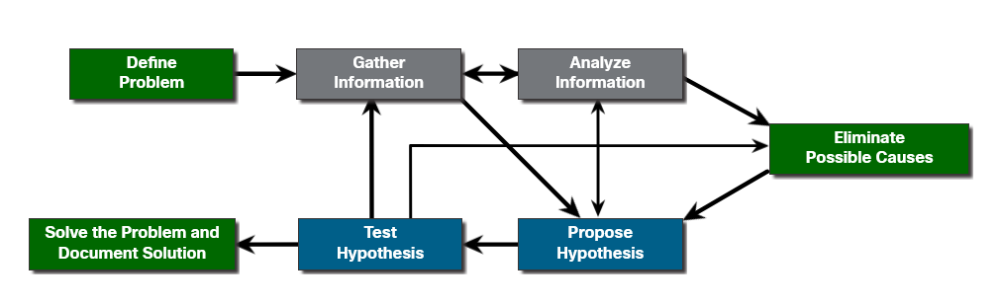

### Седемте стъпки:

1. **Дефинирайте проблема** (Define the Problem)
2. **Съберете информация** (Gather Information)
3. **Анализирайте информацията** (Analyze Information)
4. **Елиминирайте възможните причини** (Eliminate Possible Causes)
5. **Предложете хипотеза** (Propose Hypothesis)
6. **Тествайте хипотезата** (Test Hypothesis)
7. **Решете проблема** (Solve the Problem)

**Забележка:** Процесът не винаги е линеен - може да се налага връщане към предишни стъпки при нова информация.

---

### Стъпка 1: Дефинирайте проблема

**Цел:** Проверка че има проблем и правилно дефиниране какъв е той.

Проблемите се идентифицират чрез симптоми:
- Мрежата е бавна или е спряла
- Предупреждения от системата за управление
- Съобщения от конзолата
- Оплаквания от потребители

**Важни действия:**
- Задавайте въпроси
- Изследвайте проблема
- Локализирайте обхвата (едно устройство, група, подмрежа, цяла мрежа)

**Системи за заявки:**  
В организациите се използват **trouble tickets** - заявки за поддръжка, проследявани със специализиран софтуер.

**Функции на софтуера:**
- Портал за самообслужване
- База данни със заявки
- Възможности за отдалечен контрол

---

### Стъпка 2: Съберете информация

Идентифицирайте целите за изследване, получете достъп и съберете:
- Информация за устройствата
- Логове и съобщения за грешки
- Конфигурационни файлове
- Топологични диаграми
- Резултати от диагностични команди

---

### Стъпка 3: Анализирайте информацията

Възможните причини трябва да бъдат идентифицирани чрез:
- Мрежова документация
- Мрежови базови линии
- Организационни бази данни със знания
- Търсене в интернет
- Разговори с други техници

---

### Стъпка 4: Елиминирайте възможните причини

При множество причини, намалете списъка чрез прогресивно елиминиране.

**Опитът при отстраняване на неизправности е изключително ценен** за бързо идентифициране на най-вероятната причина.

---

### Стъпка 5: Предложете хипотеза

Формулирайте решение въз основа на най-вероятната причина.

**Елементи:**
- Какво е проблемът?
- Какво ще направите?
- Какви са очакваните резултати?

---

### Стъпка 6: Тествайте хипотезата

Преди тестване, оценете:

**Въздействие:** Може ли решението да засегне други системи?

**Спешност:** Претеглете сериозността спрямо въздействието.

**Временни решения:** Понякога се създава workaround докато проблемът не бъде окончателно разрешен.

---

### Стъпка 7: Решете проблема

След разрешаване:
- Информирайте потребителите
- Уведомете ИТ екипа
- **Документирайте причината и решението**

**Ключови елементи на документацията:**
- Описание на проблема
- Предприети стъпки
- Крайно решение
- Използвани команди и инструменти
- Дата, час и име на техника

---

## Отстраняване на неизправности с OSI модела

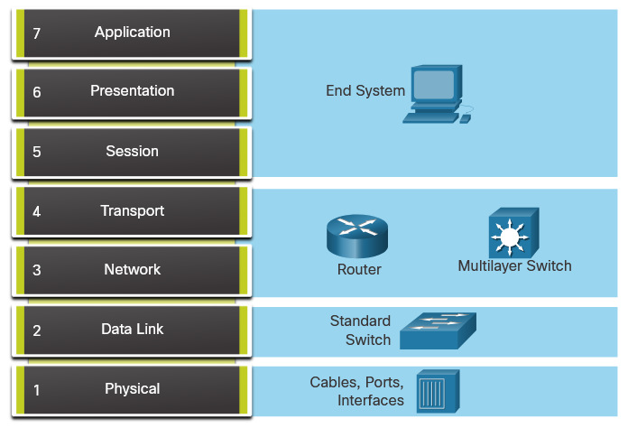

OSI и TCP/IP моделите помагат за изолиране на мрежови проблеми.

**Пример:** При проблем с физическата връзка, фокусирайте се върху кабели и връзки на физическия слой.

### Устройства и OSI слоеве:

| Устройство | Проверявани слоеве |
|------------|-------------------|
| Кабели | Layer 1 |
| NIC | Layer 1-2 |
| Безжични точки | Layer 1-2 |
| Комутатори | Layer 1-2-3 |
| Рутери | Layer 1-2-3-4 |
| Защитни стени | Layer 1-2-3-4 |

**Забележка:** Рутерите и многослойните комутатори са на Layer 4, защото ACL могат да филтрират базирано на транспортен слой.

---

## Структурирани методи за отстраняване на неизправности

### 1. **Bottom-Up (Отдолу нагоре)**
Започнете с физическия слой и се движете нагоре през OSI модела.

### 2. **Top-Down (Отгоре надолу)**
Започнете с приложенията и се движете надолу.

### 3. **Divide-and-Conquer (Разделяй и владей)**
Направете информирано предположение на кой слой да започнете.

### 4. **Follow-the-Path (Следвайте пътя)**
Проследете трафика от източник до дестинация.

### 5. **Substitution (Замяна)**
Заменете проблемното устройство с работещо.

### 6. **Comparison (Сравнение)**
Сравнете работещи и неработещи конфигурации.

### 7. **Educated Guess (Образована догадка)**
Използвайте опит и интуиция.

---

## Насоки за избор на метод

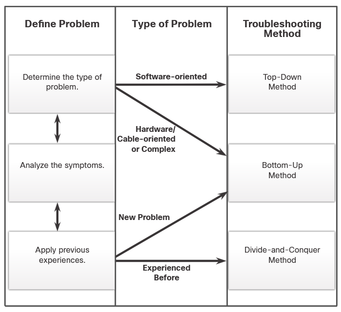

**Софтуерни проблеми** → Top-Down

**Хардуерни проблеми** → Bottom-Up

**Нови проблеми (опитен техник)** → Divide-and-Conquer

**Други** → Bottom-Up

**Важно:** Отстраняването на неизправности е умение, което се развива чрез практика!

---

## Документиране на констатациите

### Документирайте:

**1. Проблема:**
- Първоначален доклад
- Описание на симптомите
- Събрана информация

**2. Решението:**
- Предприети стъпки

**3. Команди и инструменти:**
- Използвани при диагностика
- Използвани при решаване

### Проверка с клиента:

- Покажете как решението коригира проблема
- Нека клиентът тества
- Актуализирайте документацията

---

# МОДУЛ 2: Мрежова документация

## Общ преглед

**Точна и пълна мрежова документация е необходима** за ефективно мониториране и отстраняване на неизправности.

### Обща документация включва:

1. Физически и логически топологични диаграми
2. Документация на мрежовите устройства
3. Базова линия на производителността

**Съхранение:**
- На едно място (хартиено или на защитен сървър)
- Резервно копие на отделно място

---

## Топологии на корпоративни мрежи

### Физическа топология

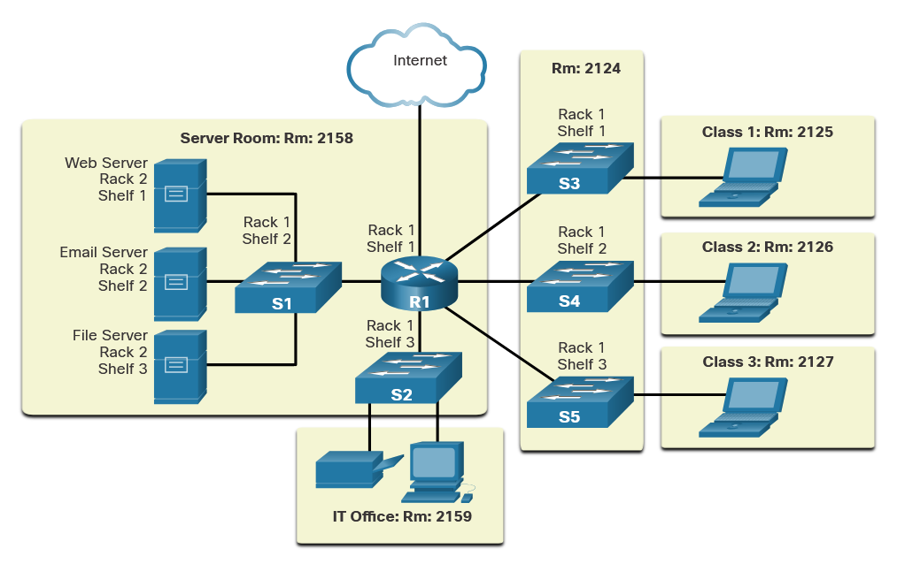

Показва физическото местоположение и функция на устройствата.

### Логическа топология

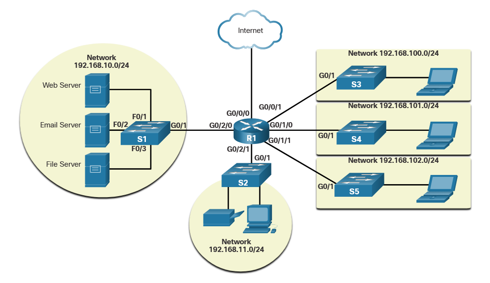

Показва свързващите интерфейси и адресната схема на Layer 3.

---

## Корпоративни мрежи

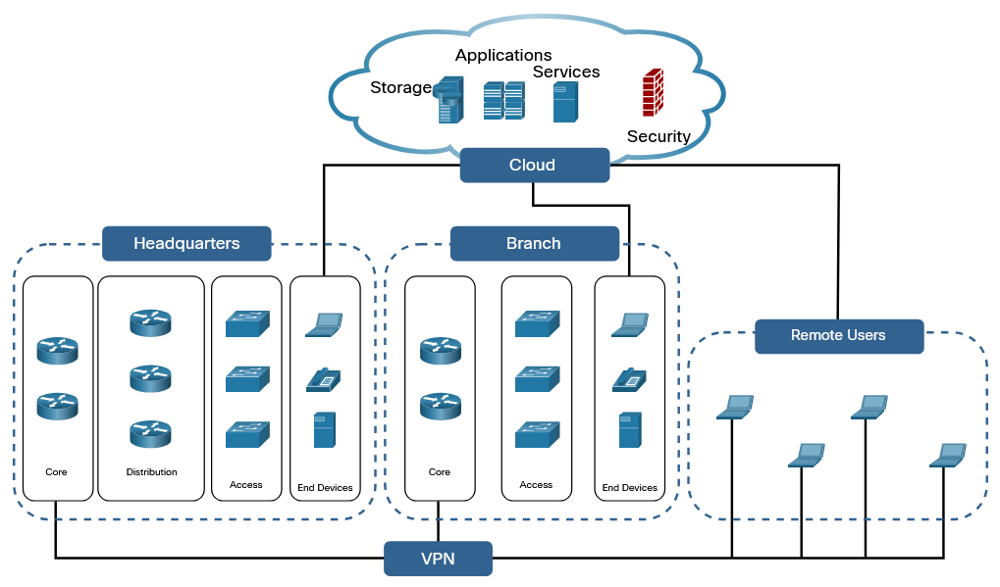

**Йерархичен дизайн:**
- Access layer (Достъп)
- Distribution layer (Разпределение)
- Core layer (Ядро)

**Важно:** Това не са шаблони - всяка мрежа е различна по размер, сложност и бюджет.

### Типове топологични диаграми:

- Физическо разположение и връзки
- IP адреси и VLAN управление
- Политики за сигурност и VPN
- Облачни услуги
- Политики за маршрутизация
- Отдалечен достъп

---

## Облачни услуги и приложения

### Три основни типа:

**SaaS - Software as a Service**

Приложения достъпни чрез браузър вместо локална инсталация.

**Примери:**
- Google Docs, Sheets, Calendar, Maps
- Office 365
- Salesforce

**Характеристики:**
- Фокус върху крайния потребител
- Документи в облака или локално
- Достъп през интернет

---

**PaaS - Platform as a Service**

Платформа за разработчици, която предоставя инфраструктура.

**Примери:**
- Microsoft Azure
- AWS Lambda
- Google App Engine

**Характеристики:**
- Фокус върху разработчиците
- Предоставя сървъри, storage, инструменти
- Разработчикът пише само код

---

**IaaS - Infrastructure as a Service**

Виртуални машини и ресурси при поискване.

**Примери:**
- Cisco Metacloud
- Microsoft Azure
- Google Compute Engine

**Характеристики:**
- За разработчици и администратори
- Доставчикът управлява VMs
- Без нужда от собствен data center

---

**XaaS - Anything as a Service**

Всичко като услуга - включва SaaS, PaaS, IaaS и още:

- DRaaS - Disaster Recovery
- CaaS - Communications
- MaaS - Monitoring
- DaaS - Desktop

---

## Документация на мрежовите устройства

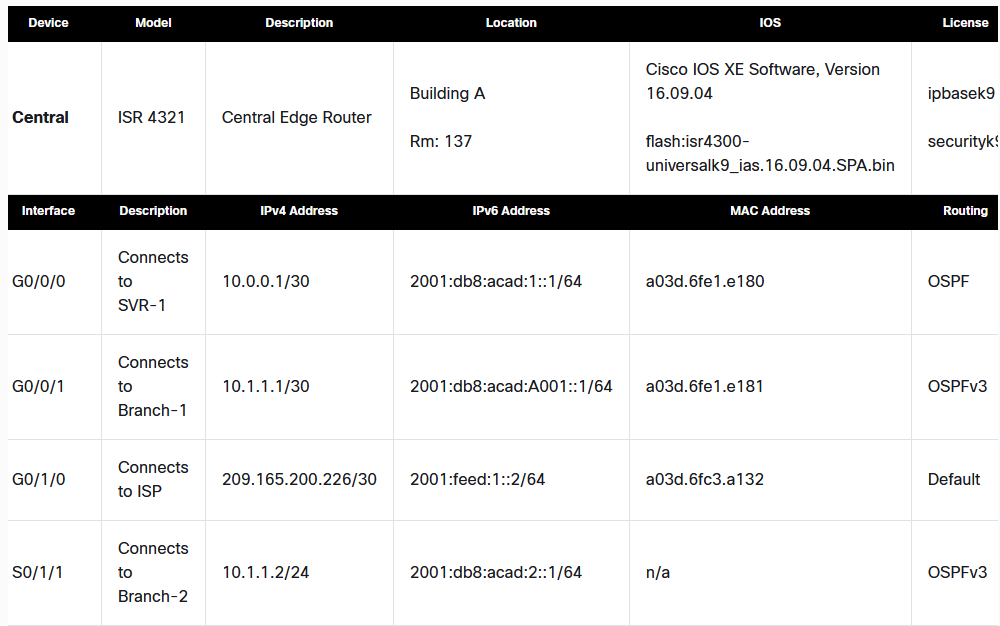
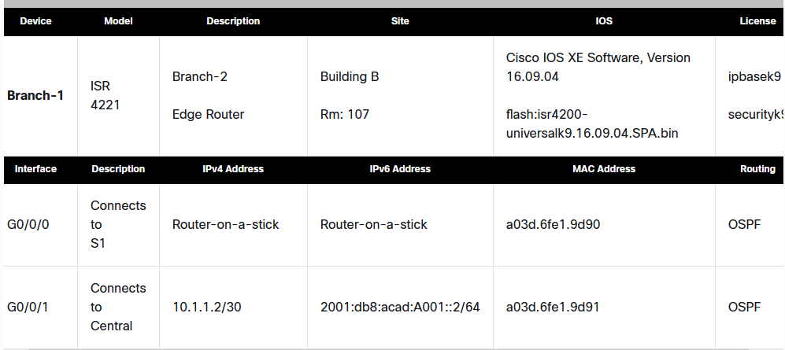

Документацията трябва да съдържа:
- Име на устройството
- Местоположение
- IP адреси на интерфейсите
- Маски на подмрежата
- Default Gateway
- DNS сървъри
- Статични маршрути
- Версия на IOS

Много организации използват таблици или spreadsheets.

---

## Cisco Discovery Protocol (CDP)

**CDP** е Cisco проприетарен Layer 2 протокол за събиране на информация за Cisco устройства.

**Характеристики:**
- Независим от медията и протокола
- Работи на рутери, комутатори, сървъри
- Изпраща периодични съобщения

**Споделя информация за:**
- Тип на устройството
- Име на устройствата
- Брой и тип интерфейси

**Приложения:**
- Мрежови дизайнерски решения
- Отстраняване на неизправности
- Създаване на логическа топология

---

# МОДУЛ 3: Мрежови заплахи, уязвимости и атаки

## Домейни на заплахите

**Домейн на заплахата** е област на контрол, власт или защита, която атакуващите могат да експлоатират.

### Атакуващите експлоатират системи чрез:

- Директен физически достъп
- Безжични мрежи отвъд границите
- Bluetooth или NFC устройства
- Злонамерени прикачени файлове
- По-слабо защитени елементи във веригата на доставки
- Акаунти в социални мрежи
- Преносими носители (USB)
- Облачни приложения

---

## Видове киберзаплахи

### 1. Софтуерни атаки
- Успешна DoS атака
- Компютърен вирус

### 2. Софтуерни грешки
- Програмни бъгове
- Спиране на приложение
- XSS, неправомерно споделяне

### 3. Саботаж
- Компрометиране на база данни
- Обезобразяване на уебсайт

### 4. Човешка грешка
- Грешки при въвеждане
- Неправилна конфигурация

### 5. Кражба
- Откраднати лаптопи/оборудване

### 6. Хардуерни откази
- Срив на твърд диск

### 7. Прекъсване на услуги
- Спиране на електричеството
- Щети от вода

### 8. Природни бедствия
- Бури, торнадо
- Земетресения
- Наводнения
- Пожари

**Допълнение:** Киберпрестъпниците често комбинират техники за по-голям успех.

---

## Вътрешни и външни заплахи

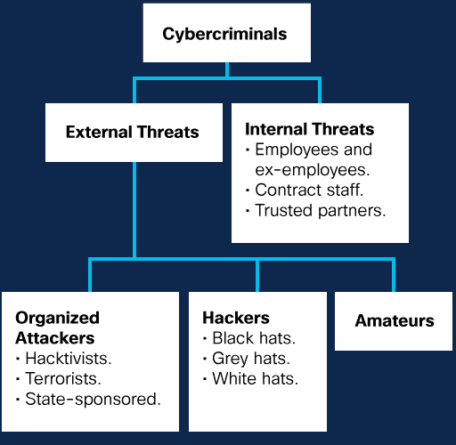

### Вътрешни заплахи

**Извършват се от:**
- Настоящи или бивши служители
- Договорни партньори

**Начини:**
- Невнимание или умишлено
- Неправилна обработка на данни
- Заразени носители
- Злонамерени имейли/уебсайтове

**Опасност:** По-големи щети от външни, защото имат:
- Пряк достъп до помещения
- Вътрешно познание за мрежата
- Познания за мерките за сигурност

---

### Външни заплахи

**Произхождат от:**
- Аматьорски атакуващи
- Квалифицирани атакуващи

**Методи:**
- Експлоатиране на уязвимости
- Социално инженерство
- Измама

---

## Потребителски заплахи и уязвимости

Потребителският домейн включва служители, клиенти и партньори.

**Потребителите са най-слабото звено** в информационната сигурност!

### Често срещани заплахи:

**Липса на осведоменост**  
Потребителите трябва да познават политиките и технологиите за защита.

**Слабо прилагане на политики**  
Потребителите трябва да разбират последиците от неспазване.

**Кражба на данни**  
Причинява финансови щети и репутационни загуби.

**Неразрешени изтегляния**  
Много инфекции идват от изтегляне на файлове или използване на USB.

**Неоторизирани VPN**  
VPN може да прикрие кражба чрез криптиране.

**Неразрешени уебсайтове**  
Опасни скриптове, adware или поемане на контрол.

**Унищожаване**  
Случайно или умишлено саботиране на системи.

**Важно:** Няма техническо решение, което да компенсира лошото поведение на потребителите!

---

## Заплахи за устройствата

**Устройства без надзор**  
Риск от неоторизиран достъп.

**Изтегляния от ненадеждни източници**  
Изпълнение на злонамерен код.

**Уязвимости в софтуера**  
Използвани за атаки.

**Нови вируси и малware**  
Постоянна заплаха.

**Неоторизирани USB, CD, DVD**  
Заразяване или компрометиране.

**Нарушаване на политики**  
Сериозни последици.

**Остарял хардуер/софтуер**  
Увеличена уязвимост.

---

## Заплахи за локалната мрежа (LAN)

**Неоторизиран достъп**  
До комуникационни шкафове и сървърни помещения.

**Неоторизиран достъп**  
До системи, приложения и данни.

**Уязвимости**  
В мрежовата OS или софтуер.

**Безжични мрежи**  
Нерегламентиран достъп от външни.

**Прихващане на данни**  
По време на предаване.

**Разнороден хардуер**  
Затруднява управлението.

**Сканиране на портове**  
Неразрешено сондиране.

**Неправилни firewall конфигурации**

---

## Заплахи за частния облак

**Сканиране**  
Неразрешено сондиране и сканиране.

**Неразрешен достъп**  
До ресурси.

**Уязвимости**  
В OS на рутери, firewall, мрежови устройства.

**Грешки в конфигурацията**  
На критични устройства.

**Отдалечени потребители**  
Изтегляне на чувствителни данни.

---

## Заплахи за публичния облак

**Нарушаване на данни (Data breach)**  
Неоторизиран достъп.

**Загуба на интелектуална собственост**  
Кражба на IP.

**Компрометирани акаунти**  
Account hijacking.

**Социално инженерство**  
Манипулация на хора.

**Регулаторни нарушения**  
Неспазване на изисквания.

**Важно:** Доставчикът защитава инфраструктурата, но организацията отговаря за собствените си данни!

---

## Заплахи за приложенията

**Неоторизиран достъп**  
До data centers, сървърни помещения.

**Недостъпност**  
По време на поддръжка.

**Уязвимости**  
В системен и приложен софтуер.

**Загуба на данни**

**Уязвимости при разработка**  
В клиент-сървър и web приложения.

---

## Усложняване на заплахите

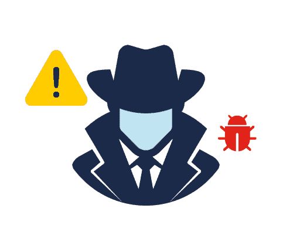

### APT атаки (Advanced Persistent Threat)

**Характеристики:**
- Продължителни, целенасочени
- Използват сложни техники
- Повече от един атакуващ
- Действат незабелязано дълго време
- Сериозни последствия
- Насочени към държави и големи организации

### Алгоритмични атаки

**Методи:**
- Използват алгоритми в легитимен софтуер
- Предизвикват нежелано поведение
- Фалшиви аларми
- Отказ чрез изчерпване на RAM/CPU

### Threat Intelligence

**Информация за заплахи:**
- Платени специализирани източници
- OSINT (Open Source Intelligence)
- Споделяне между организации
- Повишаване на общото ниво

---

## Задни врати и руткити

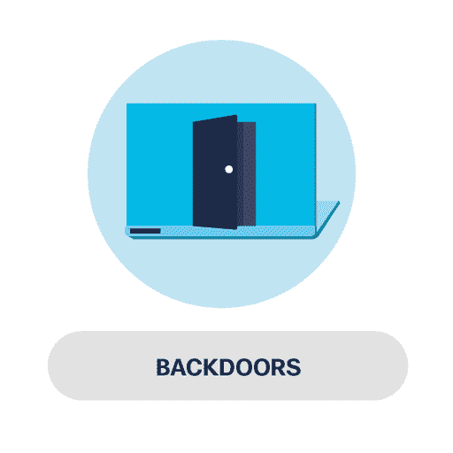

### Backdoors (Задни врати)

**Какво са:**
- Заобикалят стандартно удостоверяване
- Примери: NetBus, Back Orifice

**Как работят:**
- RAT (Remote Administration Tool)
- Административен контрол
- Постоянен достъп

### Rootkits (Руткити)

**Какво правят:**
- Модифицират операционната система
- Създават скрит достъп
- Използват уязвимости

**Характеристики:**
- Privilege escalation
- Променят системни файлове
- Манипулират мониторинг инструменти
- Трудни за откриване

**Важно:** При заразяване често е необходима пълна преинсталация!

---

## Източници на информация за заплахи

**CVE (Common Vulnerabilities and Exposures)**

Поддържан от US-CERT и DHS - речник на уязвимости.

**Всеки CVE запис съдържа:**
- Уникален идентификатор
- Описание
- Препратки

**Други източници:**

**Dark Web**  
Криптирано съдържание, изисква специален софтуер. Изследователи наблюдават за нови заплахи.

**IOC (Indicator of Compromise)**  
Сигнатури на malware, домейни - доказателства за пробив.

**AIS (Automated Indicator Sharing)**  
Обмен в реално време чрез STIX и TAXII стандарти.

---

## Социално инженерство

**Социалното инженерство** е нетехническа стратегия за манипулиране на хора.

**Използва:**
- Желание за съдействие
- Доверчивост
- Алчност
- Суета

### Често срещани техники:

**Pretexting (Претекстинг)**  
Измислен сценарий за получаване на информация.

**Quid pro quo**  
"Услуга срещу услуга" - обещана облага срещу данни.

**Identity fraud (Кражба на самоличност)**  
Използване на открадната идентичност.

---

## Тактики на социалното инженерство

### Authority (Авторитет)
Хората изпълняват искания от авторитетни фигури.

### Intimidation (Сплашване)
Притискане чрез заплахи или последствия.

### Consensus (Социално доказателство)
"Всички го правят" - приемане като правилно.

### Scarcity (Недостиг)
Ограничени ресурси подтикват към действие.

### Urgency (Спешност)
Ограничено време за решение.

### Familiarity (Познатост)
Доверие към познати или харесани.

### Trust (Доверие)
Постепенно изграждане на връзка.

**Важно:** Киберпрестъпниците комбинират техники за по-голям успех!

---

## Други измамни техники

**Shoulder Surfing**  
Наблюдение през рамо за пинкодове/пароли.

**Dumpster Diving**  
Ровене в отпадъци за документи.

**Impersonation**  
Представяне за друго лице.

**Hoaxes**  
Лъжливи предупреждения.

**Piggybacking / Tailgating**  
Следване на оторизиран служител.

**Baiting**  
Примамване чрез любопитство/алчност.

**Phishing**  
Масови съобщения, представящи се за доверен източник.

**Spear phishing**  
Насочени към конкретен човек.

**Whaling**  
Насочени към висш ръководен персонал.

**Scareware**  
Плаши потребителя да инсталира фалшив софтуер.

**Ransomware**  
Криптира данни и изисква откуп.

---

## Други методи за подвеждане

**Invoice scam**  
Фалшиви фактури.

**Watering hole**  
Заразяване на често посещавани сайтове.

**Typosquatting**  
Използване на печатни грешки в URL.

**Prepending**  
Премахване на "external" маркировка.

**Influence campaigns**  
Фалшиви новини, дезинформация.

---

## Защита срещу измамни техники

**Никога не разкривайте:**
- Поверителна информация
- Идентификационни данни
- Чрез имейл, чат, телефон

**Бъдете внимателни:**
- Не отваряйте примамливи имейли
- Внимавайте с неочаквани изтегляния
- Въведете ясни политики
- Насърчавайте отговорност
- Не се поддавайте на натиск

---

## Кибератаки

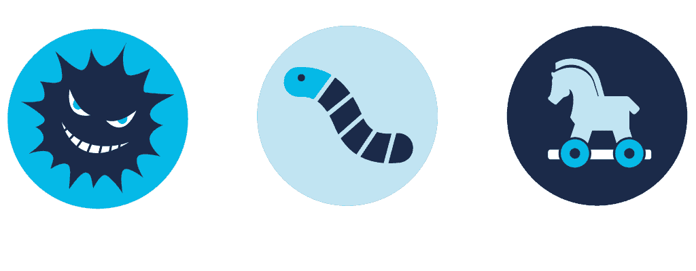

### Вируси (Viruses)

**Характеристики:**
- Самокопират се
- Прикрепят се към файлове
- Изискват действие на потребителя
- Разпространяват се през USB, интернет, имейл
- Могат да мутират

**Пример:** Melissa (1999) - щети $1.2 млрд.

### Червеи (Worms)

**Характеристики:**
- Разпространяват се самостоятелно
- Не се нуждаят от хост програма
- Не изискват действие след заразяване
- Бързо се разпространяват
- Съдържат вреден товар

**Пример:** Code Red (2001) - 300,000 сървъра за 19 часа.

### Троянски кон (Trojan Horse)

**Характеристики:**
- Представя се за легитимен
- Използва правата на потребителя
- Не се самокопира
- Прикрива се във файлове
- Отдалечен достъп, кражба

---

## Логически бомби

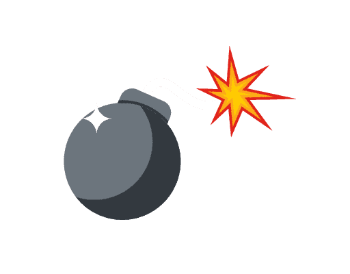

**Какво са:**
- Зловреден код, неактивен до условие
- Условия: дата, час, запис в БД

**Вреди:**
- Повреждат данни
- Изтриват файлове
- Атакуват OS

**Ново:** Увреждане на хардуер - вентилатори, CPU, памет чрез претоварване.

---

## Ransomware

**Какво е:**
- Блокира система или данни
- Изисква откуп

**Как работи:**
- Криптира файлове
- Обещава декриптиране след плащане
- Често жертвите НЕ възстановяват данни

**Разпространение:**
- Phishing имейли
- Софтуерни уязвимости

---

## Атаки за отказ на услуга (DoS)

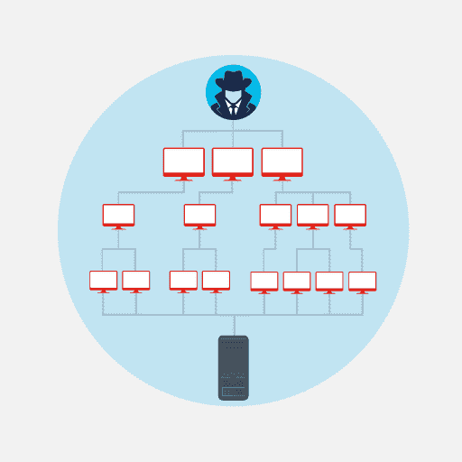

**DoS атаките:**
- Сравнително лесни за изпълнение
- Сериозен риск
- Прекъсване на услуги
- Финансови загуби

**Уязвими:**
- ИТ системи
- Оперативни технологии (сгради, фабрики)

### Видове DoS:

**Претоварване с трафик**  
Огромно количество данни.

**Злонамерени пакети**  
Грешна структура, невалидни стойности.

### DDoS (Distributed DoS)

**Процес:**
1. Създаване на ботнет
2. Заразяване на "зомбита"
3. Координирана атака

**Пример:** Persirai botnet (2017) - над 122,000 IP камери превърнати в ботнет.

---

## DNS и URL атаки

### DNS System

DNS превежда домейн име в IP адрес.

**Заплахи:**

**Domain reputation**  
Следене на репутацията на домейн и IP.

**DNS spoofing / cache poisoning**  
Фалшиви записи в кеша.

**Domain hijacking**  
Контрол над DNS информация чрез:
- Социално инженерство
- Компрометиран имейл

**URL пренасочване**  
Злоупотреба за фишинг и кражба.

---

## Layer 2 атаки

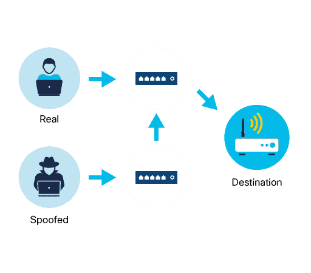

**Layer 2** = канален слой (MAC адреси, ARP)

### Spoofing / Poisoning

**MAC spoofing**  
Маскиране като легитимно устройство.

**ARP spoofing**  
Фалшиви ARP съобщения.

**IP spoofing**  
Подправен източник.

### MAC Flooding

**Процес:**
- Наводняване на комутатора с MAC адреси
- Препълване на таблицата
- Комутаторът изпраща към всички портове
- Прихващане на данни

---

## Man-in-the-Middle и Man-in-the-Mobile

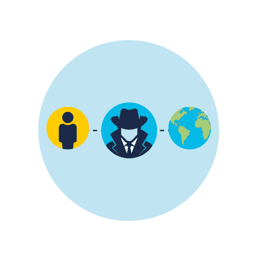

### MitM (Man-in-the-Middle)

**Какво е:**
- Прихващане на комуникация
- Промяна на данни
- Представяне за едната страна

**Може да:**
- Прихваща данни
- Променя съобщения
- Предава фалшива информация

### MitMo (Man-in-the-Mobile)

**Специфика:**
- Насочен към мобилни
- Заразено устройство изпраща данни
- Прихващане на SMS за 2FA

**Пример:** ZeuS malware

---

## Zero-Day атаки

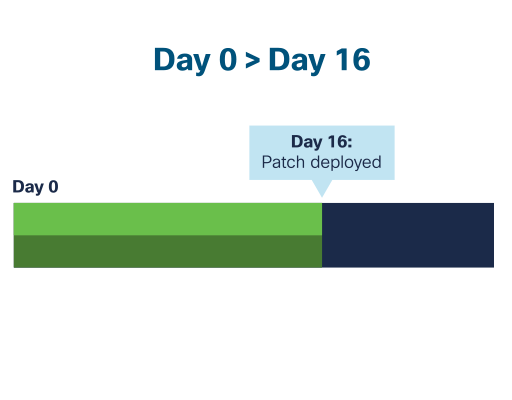

**Zero-day атака** използва уязвимост преди да е известна или преди корекция.

**Период на уязвимост:**  
Между откриването и издаването на patch.

**Защита:**
Изисква комплексен и цялостен подход към мрежовата архитектура.

---

## Keyboard Logging (Keylogging)

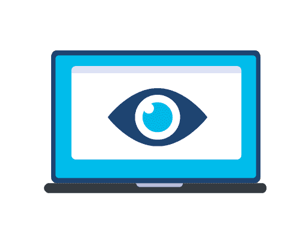

**Какво е:**
- Регистриране на натисканията
- Софтуерно или хардуерно

**Събира:**
- Потребителски имена
- Пароли
- Посещавани сайтове
- Чувствителна информация

**Защита:**
Антишпионски програми.

**Легитимна употреба:**
Родителски контрол.

---

## Защита срещу атаки

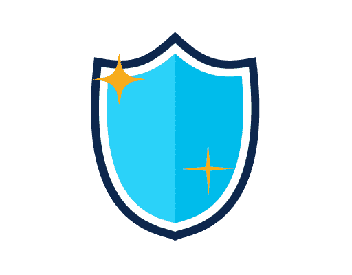

**Мерки:**

**Конфигуриране на firewall**  
Отхвърляне на spoofed пакети.

**Актуализации**  
Редовни patches и обновления.

**Load balancing**  
Разпределяне на натоварването.

**Ограничаване на ICMP**  
Блокиране на външни ICMP пакети.

**Важно:** ICMP се използва за диагностика, но може да се използва и за атаки.

---

# МОДУЛ 4: Network Security

**Цел на модула:** Конфигуриране на сигурен потребителски достъп в мрежа.

---

## The Cybersecurity Cube

Кубът за киберсигурност предоставя полезен начин за мислене за защита на данни.

### Три измерения:

**1. Security Principles (Принципи за сигурност)**

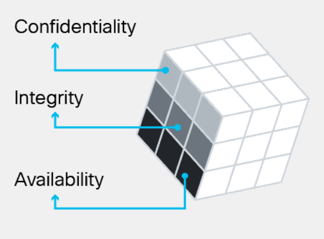

**Confidentiality (Поверителност)**  
Предотвратяване на разкриване на информация.

**Integrity (Целостност)**  
Точност, последователност и надеждност на данните.

**Availability (Достъпност)**  
Достъп за оторизирани потребители при нужда.

**CIA Triad** - основните принципи.

---

**2. Data States (Състояния на данните)**

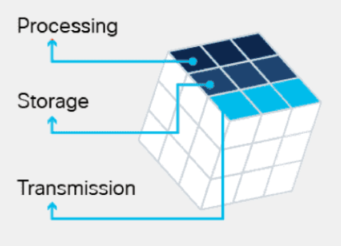

Три възможни състояния:
- Data in transit (при предаване)
- Data at rest (в съхранение)
- Data in process (при обработка)

**Ефективната киберсигурност изисква защита и в трите състояния!**

---

**3. Safeguards (Мерки за защита)**

Технологии, политики и практики.

---

## CIA Triad подробно

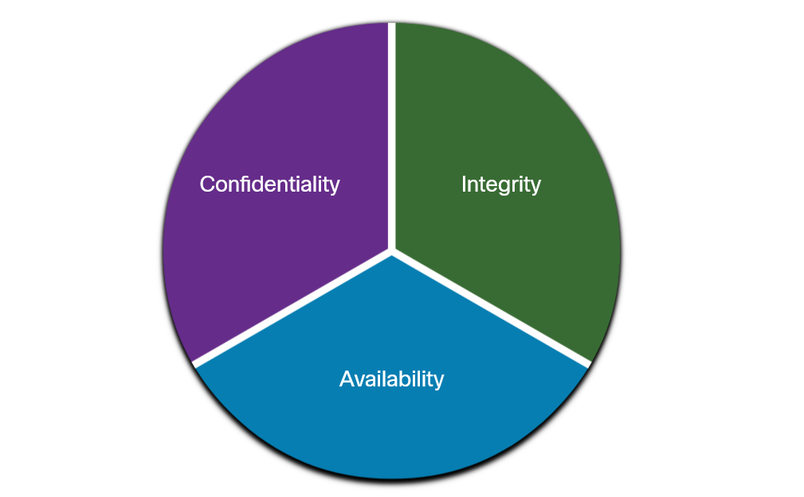

### Confidentiality (Поверителност)

**Методи:**
- AES криптиране
- Tokenization
- Rights Management (DRM, IRM)

**Tokenization:**  
Замяна с случайна стойност без математическа връзка.

**Rights Management:**
- DRM - защита на авторски права (музика, филми, книги)
- IRM - защита на организационни документи

---

### Integrity (Целостност)

**Методи:**
- Криптографски hashing (SHA)
- Защита от неоторизирани промени

---

### Availability (Достъпност)

**Методи:**
- Резервни услуги
- Резервни gateway и връзки
- Непрекъснат достъп

---

## Заключение

Тази лекция обхваща:

**Модул 1:** Диагностика и методологии
- Седемстъпков процес
- Структурирани методи
- OSI модел при troubleshooting

**Модул 2:** Мрежова документация
- Топологии
- Устройства
- Облачни услуги
- CDP протокол

**Модул 3:** Киберзаплахи
- Домейни на заплахите
- Видове атаки
- Социално инженерство
- Malware типове
- DoS/DDoS
- Layer 2 атаки

**Модул 4:** Мрежова сигурност
- Cybersecurity Cube
- CIA Triad
- Защитни мерки

**Ключов принцип:** Сигурността изисква многослоен подход - технически, организационни и човешки мерки заедно!
